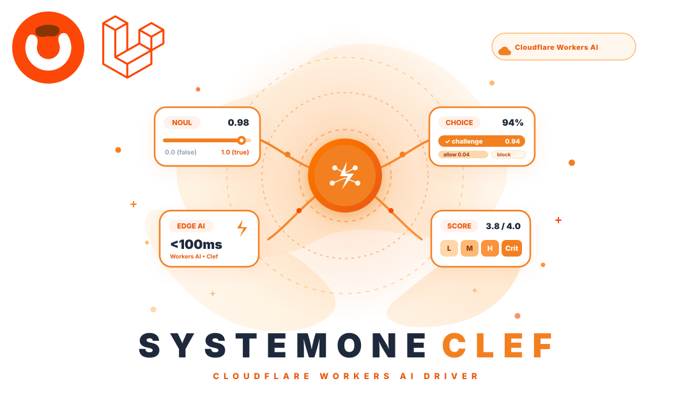

  
  
  

# Obelaw SystemOne Clef Driver

The official Cloudflare Workers AI driver adapter for the Obelaw SystemOne Decision Engine. SystemOne Clef routes decision requests directly to Cloudflare's serverless edge infrastructure across 300+ global cities, delivering sub-100ms deterministic inference with zero GPU management.

## Features

- **Cloudflare Workers AI Edge Inference**: Execute decisions globally across Cloudflare's Anycast edge network with sub-100ms latency.
- **Zero GPU Infrastructure**: Eliminate self-hosted models, Ollama daemons, cluster scaling, and expensive idle compute overhead.
- **Native Decision Primitives**: Seamlessly evaluates typed mathematical primitives—`Noul` (binary Bernoulli likelihoods), `Choice` (categorical classification with rubrics), and `Score` (bounded numerical ratings & ordered rubrics).
- **Intelligent Model Aliases**: Built-in resolution for standard decision models (`clef` / `@cf/cloudflare/clef`) and high-throughput triage models (`clef-flash` / `@cf/cloudflare/clef-flash`).
- **Calibrated Probabilities**: Access true probability distributions and confidence scores with zero hallucination risk or JSON schema drift.
- **100% Deterministic Testing**: Mock decisions offline in Pest and PHPUnit with zero token costs and zero network latency.

## Documentation

You can find the detailed documentation here in [Documentation](https://obelaw.com/docs/packages/systemone/cloudflare-clef/).

## Contributing

Thank you for considering contributing to this package! Be one of the Obelaw team.

## License

This package is an open-sourced software licensed under the [MIT license](https://opensource.org/licenses/MIT).
